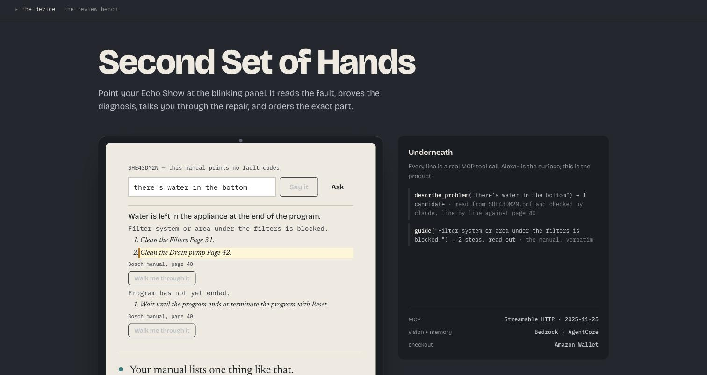
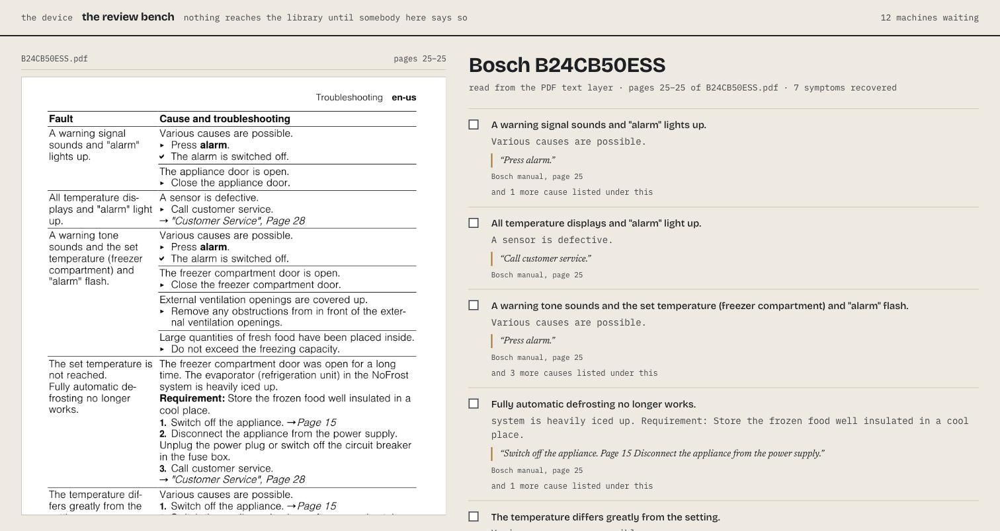

<div align="center">

<br>

# Second Set of Hands

### An appliance repair copilot for Alexa+, that will not guess.

<br>

[**Live demo**](https://second-set-of-hands.vercel.app) · [The review bench](https://second-set-of-hands.vercel.app/review.html) · [The deep dive](docs/DEEP-DIVE.md) · [For reviewers](docs/JUDGING.md)

<br>



<br>

</div>

---

You are on a kitchen floor at nine at night. The dishwasher will not drain, your hands are wet, and
the manual is a PDF you cannot hold.

**Tell it what the machine is doing, in your own words.** It answers with the sentence out of the
manufacturer's manual, the cause listed beside it, and the page it is printed on — then talks you
through the repair without your hands, and orders a part only if the diagnosis was verified.

## Try it

```bash
git clone <repo> && cd second-set-of-hands

npm run demo          # the whole loop in a terminal, ~20 seconds
npm run mcp:session   # a real MCP session — the Alexa+ deliverable, proven in one command
npm start             # http://localhost:8792 — the device experience
npm test              # 26 suites · 343 checks
```

Nothing to install. The MCP server has zero dependencies and no build step.

## The thing we got wrong, and what it taught us

We built this around fault codes. Then we read ten current Bosch dishwasher manuals fetched from
Bosch's own site and found **zero fault codes between them** — the codes moved into repair
documentation those models do not publish. What manufacturers print now is a table keyed on a
*described symptom*:

```
Fault                       Cause and troubleshooting
Water is left in the        Filter system or area under the filters is blocked.
appliance at the end of         Clean the Filters, Page 35.
the program.                Program has not yet ended.
                                Wait until the program ends.
```

So the way in is a sentence somebody says out loud. Which is also the better door: *"all the lights
are flashing"* is what a person says; `E:22` is not.

## What it refuses to do

The refusals are the product. Each one exists in code and has a test proving it still refuses.

| it will not | because |
|---|---|
| invent a procedure | somebody is following it with their hands inside a machine |
| spend money on a guess | one function may authorise spending; it declines when a cheaper cause has not been **ruled out**, when causes are within the **15%** separation threshold, or when the cause sits behind **mains** wiring |
| treat "not found" as "nothing is wrong" | it names the problems the manual *does* list instead |
| pass off a reading as a fact | every claim is tagged `read`, `checked`, or **NOT VERIFIED** |
| redistribute the manuals | the parsed quotations are committed; the pages are not |

```
  "there is a burning smell"
  → Nothing in SGE53C55UC's manual matches that description. It lists 39 problems
    and none of them is this one, which is not the same as nothing being wrong.
```

## The library, and how it came to know things

Nineteen manuals read — **433 symptoms, 795 causes**, every one citing its page — which with the
hand-written ones puts **23 machines in the library**, across five manufacturers and five kinds of
appliance. Then **every quotation is re-read off the page it cites** by script: 779 of 790 found,
and the 11 that were not are refused by name.



Nothing reaches the library without that check, and the bench above is where a person makes the one
a machine cannot: whether a cause belongs to the symptom it was filed under.

**Try it with your own machine's manual.** The bench has a drop target: give it a manufacturer's
PDF and the fault table comes back in a few hundred milliseconds, every cause citing the page it is
printed on. Nothing is uploaded and nothing is admitted — a machine-read table is a candidate.

That works on the hosted URL because reading a PDF here needs nothing installed. It used to shell
out to `pdftotext`, which is a binary, which the host does not have — so the live bench was
permanently empty and the one capability this project is for was the one thing a visitor could not
see. `manual/pdf-read.js` reads the format itself: cross-references, object streams, fonts, the
content stream, and the glyph positions that put a three-column table back into three columns.

It is measured rather than asserted. `npm run pdf:compare` runs it against poppler over every manual
on the machine and scores the thing that matters — whether the same rows come out:

| | |
|---|---|
| page count | identical on all **1,881** pages of **30** manuals |
| words | **98.4–100%** of poppler's, on every manual |
| parsed rows | **87.5%** recovered word for word, plus 287 rows poppler did not produce |

poppler still goes first where it exists, and which reader answered travels with every result.

## Hands-free, because your hands are busy

One step at a time, at the size of a headline, four feet away — and it does not advance until you
say so, because the machine has no idea whether your hands came back out.

## What is honestly not proven

The vision reader scores **7/9** fault codes and **1/1** model numbers against nine deliberately hard
panels — glare, a crouching angle, a thumb across the display. But those panels are **drawings we
rendered**, not photographs of real machines. `eval/photos/` is empty, so the claim that this reads
real appliances in a real kitchen is **UNPROVEN**, whatever the score above says.

There is one more worth knowing: asked to read a fault table on a page that has none, the vision
model produced one — seven codes, four of them using other manufacturers' conventions. It is
reproducible, it is written up in the [friction log](docs/FRICTION-LOG.md), and the guard that
catches it is arithmetic rather than a prompt.

---

<div align="center">

**[The deep dive →](docs/DEEP-DIVE.md)**  ·  nineteen tools, every decision, every bug

Amazon Developer Hackathon · Alexa+ · AWS Builder · Open Source ([faultgraph](https://github.com/vidigoat/faultgraph), MIT)

</div>
